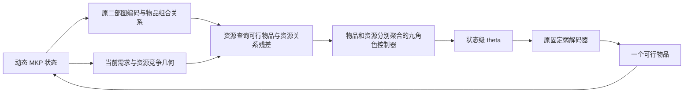

# 资源表示与高层控制器改进

本次交付代码和接口验证；完整训练与 Chu 评估由你运行。历史基线是 `results/20260922_083444_537744` 的 180 例 `learned_dynamic`，平均 gap 为 **0.3997080664%**。新结构尚无完整训练成绩，不能宣称已低于 0.1%。参考值仍为数据集 best-known。

2026-10-21 最终 CPU 回归共 109 项：**105 通过，4 项 CUDA 测试主动跳过，0 失败/错误**。固定弱解码器、候选分布、θ 数据结构及交互/搭配基函数与修改前的 AST 相同；训练 `--help` 检查通过。覆盖资源几何、单位缩放、掩码、空/单候选、置换、梯度与 Critic 隔离、缓存、旧/新 checkpoint、精细标签及状态均衡、保存结果比较。记录见 `outputs/resource_strategy_v2/validation.json` 和 `cpu_tests.log`；这些是接口与回归证据。

基线平均资源利用率已约为 99.30%。进一步提高收益，关键是把资源留给更好的物品组合。既有独立资源编码/读出实验没有达到目标，所以本次保留原有组合信息通道，同时增强资源表示、策略读出和训练信号，并提供独立消融。

## 结构与研究边界



- `mkp_resource.py`：在原编码器之后，让资源节点重新读取已包含组合信息的可行物品表示，再进行资源关系注意力。原物品两两关系、选后机会损失和差异池化全部保留。
- 固定几何为 `[B,M,12]` 的资源统计及 `[B,M,M,6]` 的资源关系，涵盖当前需求、收益加权需求、剩余可容纳物品数量、共同需求及互补关系。采用 float64 容量运算；输入网络时转换为 float32。新增几何不产生 N×N 张量，原有物品关系仍有原来的开销。
- 资源和状态残差采用可学习有界门控，初始幅度 0.1，最大幅度 0.5；总需求压力采用有限的 `log1p`，不会因为资源从未成为单物品最大负载而被排除。
- `mkp_controller.py`：物品和资源各自归一化注意力，避免 N 变大时资源消息被大量物品稀释。九个角色分别读取六个标量、价格、资源交互、搭配权重，角色之间再协调。读出残差初始幅度 0.1。
- θ 的字段、范围和规模不变；输出维数取决于 M 和固定搭配基数量，不随 N 增长。弱解码器计算公式、独立 Critic 和环境收益保持原合约。新模块没有 learned per-item action score，也没有在推理中引入续行、搜索或修复。

## 训练信号

`mkp_ranking.py` 默认使用 `dense_greedy`。从冻结的更新前策略提议有限候选，包括当前 greedy、分数竞争者、高收益、不同资源密度和随机候选；从同一真实状态分别强制选择它们，再由冻结策略完成构造。每步重新生成 θ，候选续行仅用于训练。

每个状态用候选中 greedy 续行收益最高的候选，与其余候选比较；它是有限候选中的最佳，不是全局最优动作。默认最多 16 个状态、每状态 8 个候选，保留一半状态预算给轨迹后段，其余优先覆盖接近的竞争分数。greedy 比较之外，4 次共享噪声随机续行用于置信度。

令 `P` 为初始总收益、`prefix` 为已选收益，`G_i` 为完整终局收益：

`delta_i = (G_best - G_i) / max(G_best - prefix, eps)`。

实现保留 float64 标签，减去已选前缀，避免后段小幅收益差被初始总收益稀释。默认仅过滤 `delta <= 1e-6`；随机续行意见相反时降低置信度，最低为 0.25，仍保留 greedy 标签的方向。损失和全候选 KL 按来源状态均衡加权，防止贡献 7 个比较的前段状态压过只剩 1 个有效比较的后段状态。排序损失与温度无关，梯度只进入 Actor；续行不进入 PPO buffer、GAE、Critic target 或评估流程。

新增日志包括 `ranking_states_labeled`、`ranking_candidates_labeled`、`ranking_confidence_mean`、`ranking_greedy_conflicts`，应结合 `ranking_pairs`、KL 和合成验证收益查看。更密集的标签会增加训练成本；`--ranking-branch-chunk-size` 控制一次策略前向的分支数，不改变候选预算。

## 运行

在项目目录执行，先训练再评估。默认训练 N=100，分别训练 M=5 和 M=10；Chu N=100/250/500 的全部 180 例用于冻结评估。2000 是每个 M 的初始更新预算，不能据此保证 gap 达标。

```powershell
$mkpPython = 'D:\Zlb08\.envs\RL_MKPtest\Scripts\python.exe'
& $mkpPython train_ConstrainedMKP.py --resources 5 10 --updates 2000 --device cuda --checkpoint-dir checkpoints/resource_strategy_v2
& $mkpPython Benchmark_zeroShot.py --checkpoint-dir checkpoints/resource_strategy_v2 --device cuda
```

需要从新结构重新训练。旧 v5 checkpoint 可严格加载原结构用于评估；缺失的新开关会显式关闭新模块。不要用旧模型的 `--resume` 启动新结构。新训练和评估默认目录均为 `checkpoints/resource_strategy_v2`，避免覆盖历史目录。

新运行中断后，例如只恢复 M=5：

```powershell
& $mkpPython train_ConstrainedMKP.py --resources 5 --resume checkpoints/resource_strategy_v2/mkp_M5_last.pt --checkpoint-dir checkpoints/resource_strategy_v2 --updates 4000 --device cuda
```

`--updates` 是累计目标；恢复时须保留原模型开关、训练形状和种子。增加预算只是实验选择，不代表必定达到目标。

将评估程序输出的新结果目录传给达标核验工具：

```powershell
& $mkpPython compare_mkp_results.py --candidate results/新评估目录
```

工具要求数据 SHA、实例、M/N、参考值、单条轨迹和 checkpoint 身份一致，重算 gap；所有实例都必须保留且解均可行。总体平均 gap **严格小于 0.1%** 才通过。退出码 0 为达标，1 为有效但未达标，2 为结果不完整或不可比。它核验保存结果中的可行性记录和违反量；逐解独立可行性检查由 `Benchmark_zeroShot.py` 完成。

## 同预算消融

推荐先用与主实验相同的 seed、updates、训练 N 和评估协议；每个变体使用独立 checkpoint 目录。基础网络对照命令：

```powershell
& $mkpPython train_ConstrainedMKP.py --resources 5 10 --updates 2000 --device cuda --checkpoint-dir checkpoints/resource_strategy_v2_control --no-actor-resource-refinement --no-actor-type-balanced-pooling --no-actor-strategy-tokens --ranking-target-mode legacy_mixed --ranking-min-gap 0.001 --ranking-return-scale 0.02
```

| 变体 | 相对主实验的附加参数 |
|---|---|
| 仅新结构，旧学习信号 | `--ranking-target-mode legacy_mixed --ranking-min-gap 0.001 --ranking-return-scale 0.02` |
| 仅新学习信号，原网络 | `--no-actor-resource-refinement --no-actor-type-balanced-pooling --no-actor-strategy-tokens` |
| 去除资源增强 | `--no-actor-resource-refinement` |
| 去除九角色读出 | `--no-actor-strategy-tokens` |
| 去除类型分别归一化 | `--no-actor-type-balanced-pooling` |

完整验证应同时报告平均/最差 gap、M/N 与紧容量分组、可行性、推理时间及训练成本，并在多个种子复核。checkpoint 只按固定合成验证选择；Chu 成绩用于最终报告。旧基线的精确历史权重已不在现有 checkpoint 树中，保存的历史成绩仍可对照，但不可把当前同名旧权重当成原来 0.399708% 的模型。
