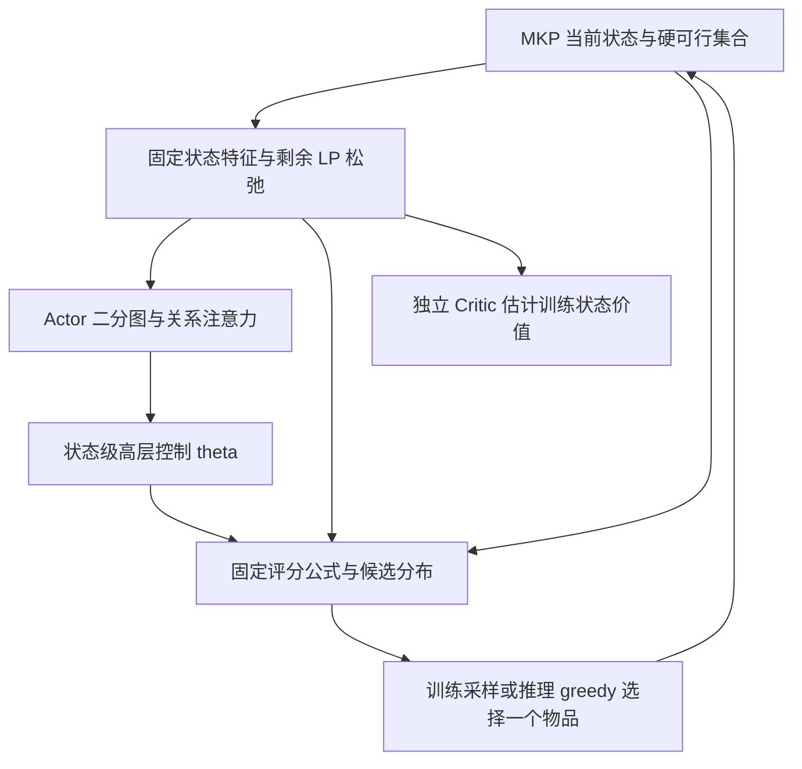

# 算法设计：高层策略控制与固定评分构造

> 核查日期：2026-10-23。技术基线：`40_lp-dual-bipartite-bound-shaping@a933ff7`。本文描述该提交的实现，不代表其他分支，也不将默认配置视为任何存档实验的实际配置。

阅读入口：[研究概览](RESEARCH_OVERVIEW.md) · [研究演进](RESEARCH_EVOLUTION.md) · [实验发现](EXPERIMENTAL_FINDINGS.md) · [开放问题](OPEN_RESEARCH_QUESTIONS.md) · [证据索引](EVIDENCE_INDEX.md)。

证据类别统一为：**A 已确认事实**、**B 已实现但未充分验证的机制**、**C 研究假设**、**D 历史探索方向**、**E 后续研究计划**。下文对代码行为的描述属于 A；这些机制能否改善学习、泛化或 Gap，除有单独实验支持外均属于 B，不能从实现存在直接推导效果。

## 1. 研究思想及架构边界

**A：模型学习如何随资源状态调整构造规则。** 对当前状态，Actor 输出资源价格、评分项权重和温度等高层控制量 `theta`（θ）。固定 `WeakDecoder` 将 θ 代入透明公式，得到当前可行物品的 categorical distribution，再逐步构造解。网络不直接输出逐物品动作 logits，也不输出逐物品 learned Q 值。

这种 Hierarchical Policy 将两个研究问题分开：状态表示能否辨识资源机会成本，以及有限控制族能否表达合适的物品排序。它保留对物品数 N 不增长的控制接口，便于解释排序变化；代价是 Actor 的可表达策略受固定评分基函数限制。**C：这种结构约束是否带来比直接物品策略更好的样本效率或 Zero-shot Generalization，当前仍需匹配实验。** 仓库不足以证明它优于所有直接自回归策略。

**A：固定参数边界不等于弱优化先验。** `WeakDecoder` 没有可训练参数、局部搜索、回溯、修复或 beam search；但当前完整策略每一步使用 residual LP relaxation，并计算两物品兼容、机会损失等固定特征。因此，“弱解码器”指固定公式和单步构造边界，不能据此判断性能主要来自 Actor。LP 先验、固定规则和学习控制各自贡献仍需消融。

源码：[模型与固定解码器](../../mkp_Model.py#L228)、[LP 结构先验](../../mkp_lp.py#L1)、[固定组合基函数](../../mkp_basis.py#L1)。

Critic 不参与推理选物品。上述循环在没有可行物品时终止。

## 2. 问题、状态及约束

对 N 个物品、M 种资源，目标是求解 Multidimensional Knapsack Problem：

$$
\max_{x\in\{0,1\}^{N}}\sum_i p_i x_i,
\qquad \sum_i w_{ij}x_i\le C_j\quad(j=1,\ldots,M).
$$

状态记录静态实例与已选历史：

| 字段 | 批量形状 | 含义与精度 |
| --- | --- | --- |
| `profits` | `[B,N]` | 非负利润，float64 |
| `weights` | `[B,N,M]` | 非负资源消耗，float64 |
| `capacities`、`remaining` | `[B,M]` | 初始容量、剩余容量，float64 |
| `selected` | `[B,N]` | 已选物品，bool |

其中 B 为 batch size。动作空间由环境精确给定：

$$
\mathcal F(s)=\{i:\neg\mathrm{selected}_i\ \land\ \forall j,\ w_{ij}\le c_j\}.
$$

必须区分三件事：

- **已选掩码**阻止重复选取；**可行性掩码**同时检查剩余资源并限定合法动作。这两者都是确定性规则。
- Actor 默认在物品消息和普通池化中使用可行性掩码，物品关系模块也排除自身与无效候选。这是在给定物理集合中组织表示。
- 资源价值、候选关系及长期后果的学习属于 B。输出始终可行不能证明模型自行学会了约束，也不能证明模型理解了长期资源机会成本。

环境没有主动 `stop` 动作；活跃实例每步必须选一个合法物品，无可行物品才终止。已终止实例使用 `-1` 占位。float64 用于物理容量判断和更新，float32 用于网络输入及大部分评分。

源码：[状态与环境转移](../../mkp_env.py#L7)、[候选集合与评分](../../mkp_Model.py#L369)。

## 3. 从当前状态到高层表示

### 3.1 物品—资源二分图

**A：基础特征同时提供局部效率、资源需求和残余 LP 信息。** 物品与资源没有位置编码，编码器通过双向 cross-attention、物品注意力和资源注意力交换信息。边特征进入注意力 bias；Actor 默认还将边特征写入 Value 消息。

| 输入 | 基础维度 | 内容概要 |
| --- | ---: | --- |
| 物品节点 | 12 | 利润、相对初始/剩余容量的负载、已选与可行状态、超载摘要；另含 4 个 LP 通道 |
| 资源节点 | 9 | 剩余比例、消耗比例、未选/可行需求；另含 3 个 LP 通道 |
| 物品—资源边 | 4 | 初始与当前相对消耗、容量差；另含 1 个 LP 对偶成本通道 |
| 全局状态 | 8 | 已得利润比例、已选/可行比例、容量摘要；另含 2 个剩余 LP 上界通道 |

默认 `embed_dim=128`、`num_heads=8`、`num_layers=2`。Actor 增加以下候选后果表示：

- 每个物品增加 4 维选后特征，故输入为 `[B,N,16]`：阻断收益质量、平滑兼容收益质量、仍可行比例和平滑余量损失。
- 每条物品—资源边增加 2 维资源归因，故输入为 `[B,N,M,6]`：该资源导致的阻断收益质量及余量损失。
- `[B,N,N,7]` 物品关系描述利润差、负载差、共同装入余量、是否冲突、平滑兼容性、余量侵蚀及对方收益质量；这些进入 `PairRelationAttention` 的 bias 和 Value。
- 4 个 learned opportunity queries 聚合竞争信息；`CriticalContrastPool` 比较相近候选的有向表示差，减少稀有关键差异在普通均值中的稀释。

这些关系是当前状态上的固定几何计算，**没有执行多步环境续行，也没有直接预测最优终局收益**。两物品能否共同装入只刻画局部兼容，不能穷尽多步组合效应。注意力头是否学到某种资源语义也没有预先保证。

源码：[特征与编码器](../../mkp_Model.py#L30)、[候选关系](../../mkp_attention.py#L40)、[关系注意力与差异池化](../../mkp_attention.py#L95)、[默认模型配置](../../mkp_config.py#L115)。

### 3.2 独立 Critic

**A：Actor 与 Critic 不共享编码器参数。** Critic 使用基础二分图输入，包括 LP 通道，但不启用 Actor 的选后特征、物品关系注意力、竞争查询及差异池化。其全局表示经线性头输出标量 V(s)，作为 PPO baseline。LP 信息已经改变了 Critic 输入，因此不能把 v6 的 Critic 称为与早期版本完全相同。

Actor 另有逐物品可行性预测头，其 BCE target 是环境给定的 `state.feasible`。该预测头只提供辅助状态监督，输出不进入 `WeakDecoder`；默认输入本身也含可行性信息，预测准确率不能作为独立的约束理解证据。

源码：[Actor 输出头](../../mkp_Model.py#L228)、[模型封装与独立 Critic](../../mkp_Model.py#L423)、[辅助损失](../../mkp_Trainer.py#L185)。

## 4. 高层控制 θ：含义、形状与范围

资源价格由资源表示和全局表示共同生成：

$$
\pi_j=\varepsilon_{\pi}+(1-\varepsilon_{\pi})M\,
\operatorname{softmax}(h)_j,\qquad \varepsilon_{\pi}=0.05.
$$

因此价格严格为正、资源均值为 1；它表示评分中的相对资源成本，**并非 LP 对偶变量 y**。其余全局标量由 sigmoid 输出映射到配置范围；资源对系数由对称资源表示产生。

| θ 分量 | 形状 | 当前默认范围/总幅度 | 作用 |
| --- | --- | --- | --- |
| `resource_prices`，π | `[B,M]` | 正值、均值 1 | 相对资源价格 |
| `profit_exponent`，α | `[B]` | `[0.5,2]` | 利润强调程度 |
| `scarcity_exponent`，β | `[B]` | `[0,3]` | 剩余容量稀缺度指数 |
| `bottleneck_weight`，κ | `[B]` | `[0,2]` | 最大相对负载惩罚 |
| `temperature`，τ | `[B]` | `[0.05,1]` | categorical 温度 |
| `opportunity_weight`、`reserve_weight`，λ、ρ | 各 `[B]` | 各 `[0,4]` | 阻断收益与余量损失惩罚 |
| `lp_primal_weight`、`lp_dual_weight`，η、δ | 各 `[B]` | 各 `[0,4]` | LP 原始保留倾向与约化成本 |
| `resource_interactions`，A | `[B,M,M]` | 对称、非负；上三角和不超过 3 | 单资源平方及跨资源组合成本 |
| `companion_weights`，b | `[B,K]` | 非负；总和不超过 2 | 固定多尺度搭配基函数权重 |

表中闭区间表示配置边界；sigmoid 通常输出内部值，上界为 0 的消融会直接关闭相应项。默认 K=3，尺度为 `(0.5,2,8)`。非重复输出条目数是

$$
M+8+\frac{M(M+1)}2+K,
$$

默认 M=5 时为 31，M=10 时为 76；该计数未扣除价格归一化等冗余，并非独立自由度。它不随 N 增长，但包含随 M 二次增长的资源对系数。

初始化为 π=1、α=β=1、κ=λ=ρ=0.1、τ=0.2、η=δ=0.5，A 上三角与 b 的总质量各为 0.02。这是初始化规则，不能当作学习所得行为。当前 `interaction_gate` 与 `companion_gate` 只连续控制对应系数总幅度；**当前没有通用 Gated Intervention/Selective Intervention 触发器，也没有独立的效率 gate 字段。**

源码：[θ 数据结构与控制头](../../mkp_Model.py#L203)、[组合控制头](../../mkp_basis.py#L16)、[范围和初值](../../mkp_config.py#L115)。

## 5. 固定 Low-level Solver 如何构造物品分布

令 c_j 为当前剩余容量，定义

$$
q_{ij}=Nw_{ij}/C_j,\quad s_j=C_j/\max(c_j,\epsilon),\quad
d_i=\frac1M\sum_j\pi_j q_{ij}s_j^{\beta}.
$$

对 i∈F(s)，温度缩放前的评分为

$$
\begin{aligned}
S_i={}&\alpha\log\max(p_i/\overline p,\epsilon)-\log d_i
-\kappa\max_j\frac{w_{ij}}{\max(c_j,\epsilon)}\\
&-\lambda L_i-\rho R_i
+\eta\log(x_i^{LP}+0.01)+\delta\,\operatorname{clip}(r_i^{LP},-100,100)\\
&-\sum_{r\le s} A_{rs}z_{ir}z_{is}+\sum_k b_k F_{ik},\\
P(i\mid s)={}&\operatorname{softmax}_{i\in\mathcal F(s)}(S_i/\tau).
\end{aligned}
$$

这里 `overline p` 是全实例平均利润；LP 的利润归一化另用当前可行平均利润。`0.01`、`100` 为当前默认配置的 `lp_primal_floor`、`feature_clip`，实际实验必须读取对应 `model_config`。零总消耗物品使用 ε 成本；实现用 log-sum-exp 避免稀缺度幂的溢出。

固定基函数的意义如下：

- L_i 是选 i 后变得不可行的其他当前可行物品的利润，占决策前可行利润总量的比例。R_i 用最小相对容量余量的 sigmoid 衰减，给出相同口径的平滑机会损失。两者都排除 i 自身。
- z_ij=w_ij/(w_ij+当前可行物品在资源 j 的平均消耗)，取值在 `[0,1]`；它避免直接使用 `w/C` 时二阶项随 N 变小。
- F_ik 在能与 i 同时装入的不同可行物品 j 中，取“有界两物品利润质量 × 多尺度余量匹配”的最大值。利润质量为 `(p_i+p_j)/(p_i+p_j+2*mean_feasible_profit)`，余量在当前可行平均资源需求单位下归一化后乘指数衰减。

搭配计算只返回固定特征值，不选取或锁定第二个动作。实际选入 i 后重新计算状态与 θ。**B：这些局部代理是否与更优长期排序一致，需用终局收益验证。**

`CandidatePolicy` 只存储真实候选，按实例分段归一化。训练采样使用 Gumbel-max；greedy 取最大评分，完全并列时取最小原物品索引。正温度不会改变同一 θ 下的 greedy 排序，所以温度贴下界本身不能证明 greedy 解质量提高。

源码：[固定评分与机会项](../../mkp_Model.py#L319)、[组合基函数](../../mkp_basis.py#L52)、[候选分布](../../mkp_Model.py#L274)。

## 6. Residual LP：结构先验、上界及局限

**A：每个状态仅对当前可行且未选物品计算 LP relaxation。** 非负资源消耗保证当前不可行物品以后也不会重新可行。以当前可行平均利润（下限 ε）记为 μ，归一化收益，并以 c_j 归一化资源：

$$
\widehat p_i=p_i/\mu,\qquad \widehat w_{ij}=w_{ij}/\max(c_j,\epsilon),
$$

$$
D_{\upsilon}(y)=\sum_j y_j+\upsilon\sum_{i\in\mathcal F(s)}
\operatorname{softplus}\left((\widehat p_i-\widehat w_i\cdot y)/\upsilon\right),\quad y\ge0.
$$

实现采用 8 级平滑温度 `(1,0.3,0.1,0.03,0.01,0.003,0.001,0.0003)`，每级 5 步 projected Newton，并行回溯线搜索含保留当前点。计算使用 float64、`torch.no_grad()`；Actor、Critic 与 decoder 在同一状态共享缓存结果。

输出约化成本 `r_i^LP=hat p_i−hat w_i·y`，以及 `x_i^LP=sigmoid(r_i^LP/upsilon_final)`。后者是平滑原始特征，**不保证精确满足容量约束，也没有整数最优证书**。对任意非负 y，弱对偶给出上界

$$
U(s)=\min\left\{\mu\left[\sum_j y_j+\sum_{i\in\mathcal F(s)}\max(r_i^{LP},0)\right],
\sum_{i\in\mathcal F(s)}p_i\right\}.
$$

终止状态 U=0。该上界是剩余可达利润的上界，不是当前整数最优值；其与解的差还包括 LP integrality gap 和近似求解的松弛度。单位边界及数值有效性需要结合对应测试容差理解。

LP 的作用有三条同时开启的通路：节点/边/全局输入、θ 控制的评分项，以及训练奖励势函数。将 LP 评分权重上界设为 0 **仍保留 LP 输入通道与求解成本**，不能称为完整“无 LP”消融。对偶价格是否比学习价格更重要、收益来自哪一通路，当前尚缺匹配归因。

源码：[LP 定义与求解](../../mkp_lp.py#L1)、[缓存及势函数](../../mkp_lp.py#L99)、[LP 通道](../../mkp_Model.py#L60)、[LP 接口测试](../../tests/test_lp_dual.py)。

## 7. 学习信号与训练流程

### 7.1 PPO 学习实际物品策略

**A：θ 是确定性的状态条件输出，不是额外采样的 Gaussian action。** PPO ratio 使用采样物品在固定评分诱导分布中的 log probability；梯度沿“物品概率 → 固定评分 → θ → Actor”传播。完整 rollout 来自 synthetic data，不将 Chu 样本放入训练或验证选择。

原始单步奖励为

$$
r_t=p_{a_t}/\sum_i p_i.
$$

默认 γ=1，完整回报与总利润同序。容量利用率只是日志指标，没有单独的利用率奖励。默认同时使用 LP potential-based reward shaping：

$$
\Phi(s)=U(s)/\sum_i p_i,\qquad
r'_t=r_t+\Phi(s_{t+1})-\Phi(s_t).
$$

终止 Φ=0，因此

$$
\sum_t r'_t=\frac{\mathrm{objective}}{\sum_i p_i}-\Phi(s_0).
$$

这确认 γ=1 时完整回报仅平移实例常数；配置在开启整形时拒绝 γ≠1。**B：更细的信用分配能否降低 GAE 方差、提高 PPO 稳定性或最终 Gap 仍需验证。** 近似上界跨状态的紧度可能变化，不能把每一个 shaped reward 都等同于精确资源浪费，也不能从伸缩求和恒等式推导学习必然变好。

默认优化为 AdamW，lr=`1e-4`，GAE λ=`0.95`，PPO clip=`0.2`，value clip=`0.2`，value/entropy/可行性辅助系数分别为 `0.5/0.01/0.05`，梯度裁剪 `1.0`，target KL=`0.03`。GAE 不跨真实终止或 padding bootstrap。

源码：[rollout、整形与 GAE](../../mkp_Trainer.py#L31)、[PPO 损失](../../mkp_Trainer.py#L132)、[默认训练配置](../../mkp_config.py#L13)。

### 7.2 训练期关键候选成对续行

**A：ranking supervision 的标签是冻结当前策略的终局续行估计，不是 Oracle 或 Q*。** 每次 PPO 更新前，策略参数尚未改变，从 on-policy 状态中抽取 bounded pool；默认池 64 个状态，保留最多 16 个关键候选对。每对比较 greedy anchor 与 top-8 中相近候选；选取约 3/4 困难状态、1/4 随机补充。

从同一状态分别强制选两个候选，再用更新前策略完成构造。默认各进行 1 组 greedy 及 4 组随机续行；随机两支共享按原物品索引的 Gumbel 噪声。标签是 50% greedy 收益差加 50% 随机均值收益差，并过滤小差异、高标准误及两种续行显著冲突的方向。

排序损失以温度缩放前的 score difference 预测终局差异的软标签，因此不能仅靠降低温度满足监督。标签与续行无梯度；额外分支不进入 PPO buffer、GAE 或 Critic target。排序梯度通过 θ 进入 Actor，并以完整标签状态集合上的全候选 KL 限制策略漂移。

这里的“冻结”指一次标注中的 behavior policy 固定；它不是单独训练一个强 Low-level Solver 后冻结，也不是评估高层干预贡献的对照实验。标注额外计算预算必须计入训练成本。

源码：[续行、标签过滤与排序损失](../../mkp_ranking.py#L27)、[训练接线与 KL](../../mkp_Trainer.py#L132)、[排序接口测试](../../tests/test_opportunity_ranking.py)。

## 8. 数据、checkpoint 选择与 Zero-shot 推理

以下是**当前默认值**，存档运行应以其 `config.json`、checkpoint 和 manifest 为准。

| 环节 | 当前默认约定 |
| --- | --- |
| 训练资源维度 | M=5、10 分别训练模型；不是一个模型跨 M 泛化 |
| 训练规模 | N=100；2000 updates，batch=64、minibatch=128、3 PPO epochs |
| 合成分布 | 整数占用 1–1000；容量比 0.25/0.5/0.75；80% 实例使用相关利润分布，其余独立利润 |
| 验证 | 独立 synthetic seed，默认每规模 64 实例、每 25 updates 检查 greedy 归一化收益 |
| checkpoint 选择 | 固定合成验证收益最优的 `best`，另存 `last`；不按 Chu Gap 选 checkpoint |
| 当前 schema | 6；`lp_dual_theta_v6`、`lp_dual_density_v6`；旧 schema 拒绝加载 |
| 主要推理 | 冻结模型、单轨迹 greedy；逐步更新 θ |
| 可选采样 | `learned_dynamic_sampled` 独立报告给定多轨迹预算下的最佳解 |

训练分布借鉴 Chu 风格，不声称精确复现其原始生成器。默认 N=100 的测试是未见实例测试；N=250/500 同时是跨规模测试。若实际训练加入这些 N，`size_zero_shot` 会据 checkpoint 调整。当前默认不评估跨资源维度 M 的迁移。

Benchmark 独立重算物品集合的利润、资源占用、重复物品及 maximality，保存 dataset/checkpoint SHA256。主要 `gap_pct=100*(reference−objective)/reference` 相对 MAT 的 best-known reference；`lp_gap_pct=100*(lp_bound−objective)/lp_bound` 相对 LP 上界。二者均为百分数（%），gap 之间的差值才以百分点表示；二者不能互换，也不能把 best-known 自动称为已证最优。完整实验口径见[实验发现](EXPERIMENTAL_FINDINGS.md)。

源码：[数据生成](../../mkp_data.py#L74)、[训练及模型选择](../../mkp_Trainer.py#L241)、[checkpoint 合约](../../mkp_utils.py#L57)、[构造推理](../../mkp_utils.py#L77)、[Benchmark 校验和报告](../../Benchmark_zeroShot.py#L21)。

## 9. 执行优化、消融与研究边界

**A：`mkp_performance.py` 的 runtime profile 与固定特征缓存调整执行方式。** 缓存保留无参数几何特征、LP 结果及状态副本；网络表示、θ、分数与概率在每次前向重新计算。Actor/Critic 参数仍独立。更大分块可能改变浮点舍入及后续随机轨迹，不能假定长程训练逐位相同，也不能把局部前向计时等同于完整训练提速。

当前可直接配置的消融包括 LP reward shaping、两种 LP 评分系数、二阶/搭配系数，以及 Actor 选后特征、关系注意力、差异池化和可行候选注意力。**关闭一组机制不自动恢复旧版本**：LP 通道、其他评分项、范围、初始化和 checkpoint schema 可能仍不同。当前 Benchmark 已无 `fixed` / `learned_static` 两种 baseline 路径；恢复受控对照是 E，不能把它们写成当前可直接运行的比较组。

**E：归因优先于扩展机制。** 下一步应在相同数据、种子、预算和模型选择标准下，比较未训练初始化、固定 θ、动态 θ，以及 LP 输入/评分/整形的独立贡献；同时记录决策改变、终局利润和计算成本。通用门控、learned item scoring、搜索、修复或 Oracle inference 不属于当前默认架构，不能在文档维护中悄然改变。

当前实现与接口测试最多确认公式、梯度、缓存、约束及推理合约；不能单独证明 Actor 已获得长期规划能力、LP shaping 改善学习，或最终达到 0.1% Gap。已存在的测量结论和缺口应分别追溯到[实验发现](EXPERIMENTAL_FINDINGS.md)及[证据索引](EVIDENCE_INDEX.md)，历史方案则见[研究演进](RESEARCH_EVOLUTION.md)。

源码：[执行与缓存](../../mkp_performance.py)、[训练 CLI 消融参数](../../mkp_Trainer.py#L388)、[接口检查](../../tests/test_contracts.py)。
