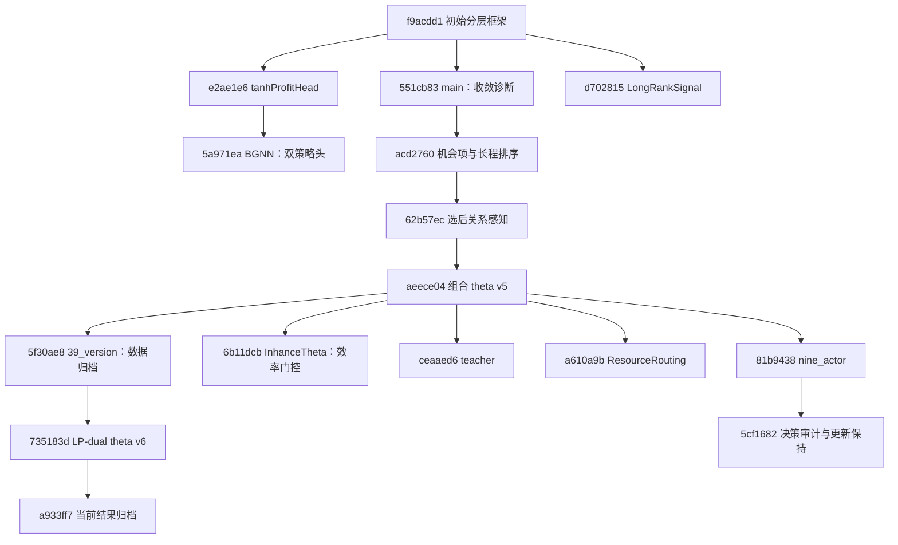

# 研究演进：共同主线与平行探索

核实日期：2026-10-23。当前研究基线为 `40_lp-dual-bipartite-bound-shaping@a933ff7`；本文记录的是该基线及本次可见 Git 历史，不把分支名称、提交标题或对话线索当作实验结论。统一入口见 [研究总览](RESEARCH_OVERVIEW.md)，证据登记见 [EVIDENCE_INDEX.md](EVIDENCE_INDEX.md)。

状态标记沿用全知识库约定：**A 已确认事实**、**B 已实现但未充分验证**、**C 研究假设**、**D 历史探索方向**、**E 后续研究计划**。历史机制可同时标注 D 与 A/B：D 说明其属于历史分支，A/B 说明当前证据强度。原始实验缺失的历史数字单列为“历史报告，当前不可复算”。

## 1. 可以还原到什么程度

**A｜现有历史始于分层范式。** `263ed52` 只有项目说明；首个实质代码提交 `f9acdd1` 已明确采用“动态 MKP 状态 → 二分图 Transformer → 高层 θ → 固定弱解码器 → 可行物品”的路线。因此，没有仓库证据支持“项目先用直接 item 策略失败，随后转向分层”的叙事。[初始提交](https://github.com/ErlkingHub/RL_ModelInhance/commit/f9acdd1)、[初始模型](https://github.com/ErlkingHub/RL_ModelInhance/blob/f9acdd1/mkp_Model.py)、[初始 README](https://github.com/ErlkingHub/RL_ModelInhance/blob/f9acdd1/README.md)。

**A｜当前分支不是所有方案的累计版本。** 现有研究提交中没有合并提交。BGNN、LongRankSignal、门控、Teacher、ResourceRouting、nine_actor 等保留在不同分叉；“未合并”不等于“被放弃”。截至本次在线核查，GitHub 的 14 个研究分支与本地对应 refs 一致，未检索到 Issues 或 Pull Requests，因而没有可补充技术决策的公开讨论记录。

**A｜结果保存覆盖远少于代码覆盖。** 所有可见 refs 中，Git 追踪的 `results/`、`runs/`、`outputs/` 实验产物仅有 `a933ff7` 加入的 [20261022_195937_430788](../../results/20261022_195937_430788/manifest.json) 结果包。分支 README 中引用的旧结果、诊断报告和提交标题中的 gap 不具备同等证据强度。当前可核实结论及复算边界见 [实验发现](EXPERIMENTAL_FINDINGS.md)。

下面的箭头只表示 Git 父子关系，不表示性能递进；图中省略部分平行探索，完整列表在第 3 节。

## 2. 当前分支的祖先链

### 2.1 2026-09-11：先规定高层与底层边界

**A｜已实现。** [f9acdd1](https://github.com/ErlkingHub/RL_ModelInhance/commit/f9acdd1) 建立二分图 Transformer、状态级 θ、无可训练参数的 `WeakDecoder`、独立 Critic、PPO 和合成训练/验证。初始 θ 为 M 个资源价格和 α、β、κ、τ 四个标量；训练采样实际物品，PPO ratio 使用该物品的概率，θ 通过固定评分公式接收梯度。初版还提供 `fixed`、`learned_static`、`learned_dynamic` 对照。

**C｜研究直觉。** 用低维资源控制量约束策略表达，希望让网络学习资源配置规则，并控制底层启发式的复杂度。初始 README 将接近或低于 0.1% gap 定义为待实验验证的目标，没有将其写成既得结果。

**证据边界。** 本仓库无法还原首版之前为什么选择这一范式，也没有首版受控训练结果。高层相对直接选择物品的优势，仍需同预算比较。源码：[初始模型](https://github.com/ErlkingHub/RL_ModelInhance/blob/f9acdd1/mkp_Model.py)、[初始评估](https://github.com/ErlkingHub/RL_ModelInhance/blob/f9acdd1/Benchmark_zeroShot.py)。

### 2.2 2026-09-17：把“训练完成”与“性能平台”区分开

**A｜实现变化。** [551cb83](https://github.com/ErlkingHub/RL_ModelInhance/commit/551cb83) 在 `main` 加入训练曲线和收敛诊断。判据基于固定独立合成验证集的 greedy 归一化收益，输出平台候选与最终状态；它不是 Chu 测试 gap 收敛判据。

**证据边界。** 提交标题提到约 3100 的曲线位置和暂定 2000 次更新，这只是历史描述。没有对应原始日志时，不能将其升级为通用的收敛更新数。源码：[该提交训练器](https://github.com/ErlkingHub/RL_ModelInhance/blob/551cb83/mkp_Trainer.py)、[诊断模块](https://github.com/ErlkingHub/RL_ModelInhance/blob/551cb83/mkp_diagnostics.py)。

### 2.3 2026-09-18：显式表达早期选择的后续机会成本

**A/B｜实现变化。** [acd2760](https://github.com/ErlkingHub/RL_ModelInhance/commit/acd2760) 同时修改控制器、评分和监督：边特征进入 Value，增加竞争摘要与状态交互；固定评分增加机会损失和剩余容量项；成对执行更新前参数固定策略的完整续行，按终局收益差提供排序监督，并检查全候选 KL。

**C｜研究动机。** 即时收益和总负载相近的物品，可能阻断不同的后续候选。仅比较当前密度可能无法区分这种长期影响；续行标签试图把终局差异传回当前排序。

**证据边界。** 参数固定的旧策略续行不是最优 Q 值；候选筛选、收益差过滤及随机续行预算会影响标签覆盖。该提交同时改变多个机制，不能把后续性能变化单独归因于“长期规划”。源码：[该提交模型](https://github.com/ErlkingHub/RL_ModelInhance/blob/acd2760/mkp_Model.py)、[排序监督](https://github.com/ErlkingHub/RL_ModelInhance/blob/acd2760/mkp_ranking.py)。当前继承实现见 [mkp_ranking.py](../../mkp_ranking.py)。

### 2.4 2026-09-20：增强高层对候选差异的读取

**A/B｜实现变化。** [62b57ec](https://github.com/ErlkingHub/RL_ModelInhance/commit/62b57ec) 增加选后兼容关系、关系 attention bias 与 Value、相似候选差异聚合及可行候选聚合。该阶段保持前一版 θ 定义和弱评分公式，重点改变 Actor 能读取的信息。

**C｜研究动机。** 若有用的组合差异在均值汇聚中被稀释，高层即使有可调参数也可能看不到应干预的状态。新增特征提供“选当前物品后哪些物品受阻”的状态信息，但没有直接预测全部未来收益。

**证据边界。** 静态两两兼容性不等于多步规划能力；微型翻转测试不证明控制器训练后能稳定使用这些信息。源码：[该提交关系模块](https://github.com/ErlkingHub/RL_ModelInhance/blob/62b57ec/mkp_attention.py)，当前文件：[mkp_attention.py](../../mkp_attention.py)。

### 2.5 2026-09-22：扩展固定评分族，而不引入学习型 item scorer

**A/B｜实现变化。** [aeece04](https://github.com/ErlkingHub/RL_ModelInhance/commit/aeece04) 加入二阶资源交互系数和多尺度搭配系数，形成 `combination_theta_v5` / `second_order_density_v5`。θ 的非重复输出条目数为 `M+6+M(M+1)/2+K`，默认 K=3。解码器使用固定二阶消耗与两物品搭配基函数，网络调节其状态级系数；同一提交还加入计算分块和固定特征缓存。

**C｜研究动机。** 资源价格和少量标量可能压缩掉联合消耗与互补搭配信息，因此扩大可控基函数族。人工设置合法 θ 的微型反例可以证明某些排序具备表达能力，不能证明训练能够找到它们。

**证据边界。** 提交标题报告约 0.56%→0.39%，历史 README 给出更精细数字；对应原始结果未进入现有 Git 历史，当前不可重新核对实例、checkpoint 与预算。缓存前向/反向局部计时也不能替代端到端训练成本或解质量消融。源码：[该提交组合模块](https://github.com/ErlkingHub/RL_ModelInhance/blob/aeece04/mkp_basis.py)、[执行优化](https://github.com/ErlkingHub/RL_ModelInhance/blob/aeece04/mkp_performance.py)；当前文件：[mkp_basis.py](../../mkp_basis.py)、[mkp_performance.py](../../mkp_performance.py)。

### 2.6 2026-10-21：39_version 归档数据，LP 分支更改信息与学习信号

**A｜提交边界。** [5f30ae8](https://github.com/ErlkingHub/RL_ModelInhance/commit/5f30ae8) 相对 `aeece04` 只修改 `.gitignore` 并加入 MKP MAT 数据，没有引入 Teacher、ResourceRouting 或 nine_actor。不能因为这些工作发生在相近日期，就将它们写入当前分支的代码祖先链。

**A/B｜LP 变化。** [735183d](https://github.com/ErlkingHub/RL_ModelInhance/commit/735183d) 基于 `5f30ae8` 加入剩余问题的平滑 LP 对偶计算，把原始解、约化成本、资源对偶信息和剩余上界写入编码；θ 增加 LP 原始解和约化成本两类评分权重；训练增加 LP 上界势函数整形，并将部分原有控制范围从 2 放宽至 3。该提交删除 `fixed` / `learned_static`，默认只评估 `learned_dynamic`。

**C｜研究动机及需要纠正的解释。** 该版本 README 用紧约束误差、资源利用率和参数接近边界解释 LP 改造。前两类历史逐实例证据当前缺失；参数饱和本身也不能证明评分族已达表达极限。“势函数整形降低 GAE 方差”需要实测，不能从回报的伸缩关系推定。当前数学与实现边界见 [算法设计](ALGORITHM_DESIGN.md)。

**证据边界。** 这次改动同时引入信息先验、评分规则和训练奖励变化，无法由单个完整配置判断各项贡献；底层虽然仍无可训练参数，但已使用每步重算的 LP 信息。源码：[mkp_lp.py](../../mkp_lp.py)、[mkp_Model.py](../../mkp_Model.py)、[mkp_Trainer.py](../../mkp_Trainer.py)、[当时 README](https://github.com/ErlkingHub/RL_ModelInhance/blob/735183d/README.md)。

### 2.7 2026-10-22：当前 LP 完整配置有了可复核评估包

**A｜归档变化。** [a933ff7](https://github.com/ErlkingHub/RL_ModelInhance/commit/a933ff7) 加入 v6 的逐实例指标、summary、manifest、物品序列和训练收敛摘要；提交标题的约 0.3099% 可以由保存的 CSV 进一步核对。这是当前知识库唯一能直接复算的正式结果包，详细口径见 [实验发现](EXPERIMENTAL_FINDINGS.md)。

**证据边界。** 现有代码 README 中“本轮未完整训练或 Chu 评估”的段落来自早先实现阶段，与后续归档时间不同，阅读时应以结果包及其可验证边界为准。当前结果说明保存策略在这批实例上的表现，不能证明 LP、整形或高层控制各自的因果贡献，也不能证明多随机种子稳定性。

## 3. 平行探索：保留代码不代表已采纳或已放弃

以下机制均属于当前仓库的历史分支。没有证据时只记录“已实现的方向”和研究假设，不赋予采用/撤销决定。

| 日期 / 分支 | 真实分叉与实现证据 | 研究问题与当前证据边界 |
| --- | --- | --- |
| 2026-09-14 `tanhProfitHead` | `e2ae1e6` 的父提交为 `f9acdd1`；新增非线性条件价格头。见 [源码](https://github.com/ErlkingHub/RL_ModelInhance/blob/e2ae1e6/mkp_Model.py)。 | **D+A/B**：全局上下文在 tanh 前与各资源交互，避免共享线性项在归一化中仅产生公共偏移。没有匹配正式结果，不能宣称降低 gap；它不在当前祖先链。 |
| 2026-09-14 `BGNN` | `5a971ea` 基于 `e2ae1e6`；BGNN 双向消息传递，独立 weak / `direct_item` 策略头。见 [BGNN.md](https://github.com/ErlkingHub/RL_ModelInhance/blob/5a971ea/BGNN.md)、[模型](https://github.com/ErlkingHub/RL_ModelInhance/blob/5a971ea/mkp_Model.py)。 | **D+A/B**：直接头为可学习 item MLP 与可行性 mask，是显式独立比较方向。两种头都顺序构造；ragged 候选与 dense mask 本身并不是算法贡献。无归档的匹配双头实验。 |
| 2026-09-15 `LongRankSignal` | `d702815` 直接基于 `f9acdd1`；归一化资源 log weights、α、κ 与终局排名损失。见 [模型](https://github.com/ErlkingHub/RL_ModelInhance/blob/d702815/mkp_Model.py)、[排名实现](https://github.com/ErlkingHub/RL_ModelInhance/blob/d702815/mkp_ranking.py)。 | **D+A/B**：M 个 log weights 加两个标量，归一化后为 M+1 个有效自由度；采样温度固定。不能把它等同于当前扩展 θ，也不能根据提交日期把它排成 main 的前一版。 |
| 2026-09-22 `thetaRollout_RankSupervised` | `6836ed3` 基于 `551cb83`；在合法 θ 域提议候选，去重诱导动作，续行与排序监督。见 [README](https://github.com/ErlkingHub/RL_ModelInhance/blob/6836ed3/README.md)、[实现](https://github.com/ErlkingHub/RL_ModelInhance/blob/6836ed3/mkp_ranking.py)。 | **D+A/B**：研究“先探索 θ 能诱导的动作，再形成训练标签”。训练候选收益不是最终策略提升；没有可复算正式结果。 |
| 2026-09-23 `inhance_ThetaRank` | `ab7ed42` 基于 `aeece04`；v5 合法 θ 候选、反事实动作续行和可重放审计。见 [候选模块](https://github.com/ErlkingHub/RL_ModelInhance/blob/ab7ed42/mkp_theta_candidates.py)、[README](https://github.com/ErlkingHub/RL_ModelInhance/blob/ab7ed42/README.md)。 | **D+A/B**：把 θ 提议用于扩展监督动作覆盖；提交标题约 0.38% 是历史声明。不是前一个 θ-rollout 分支的 Git 后继；当前没有归档审计快照来复算旧标签。 |
| 2026-10-09 `TrainGreedyLabel` | `9b0046d` 基于 `aeece04`；每对候选只做确定性 greedy 续行，并调整标签过滤/尺度。见 [实现差异](https://github.com/ErlkingHub/RL_ModelInhance/commit/9b0046d)。 | **D+A/B**：研究随机续行的噪声与成本是否必要。标题约 0.3833% 未有原始归档支持，无法确认稳定性与预算匹配。 |
| 2026-10-15 `InhanceTheta` | `6b11dcb` 基于 `aeece04`；状态级 `efficiency_gate` 与末段收益覆盖。见 [README](https://github.com/ErlkingHub/RL_ModelInhance/blob/6b11dcb/README.md)、[模型](https://github.com/ErlkingHub/RL_ModelInhance/blob/6b11dcb/mkp_Model.py)。 | **D+A/B**：让高层减弱资源效率偏好；当物理检查确认最多还能选一件时关闭该偏好。标题约 0.3991% 与旧基线的差异当前不可复算。这个门控没有进入当前 LP 祖先链。 |
| 2026-10-17 `56_version` | `44070cb` 基于 `acd2760`；该提交只改 decoder 标识/产物目录和 `.gitignore`。见 [提交差异](https://github.com/ErlkingHub/RL_ModelInhance/commit/44070cb)。 | **D+A**：其已有机会项/排序机制继承自父提交；标题约 0.56% 与“2 小时 780 轮”是运行声明，没有归档数据，不能视为新的架构修改或可比较端到端基准。 |
| 2026-10-20 `teacher` | `ceaaed6` 基于 `aeece04`；包含资源几何/读出、成本门控、精确或有预算 MILP 教师、独立 Actor 监督与回退。见 [README](https://github.com/ErlkingHub/RL_ModelInhance/blob/ceaaed6/README.md)、[教师](https://github.com/ErlkingHub/RL_ModelInhance/blob/ceaaed6/mkp_teacher.py)、[监督更新](https://github.com/ErlkingHub/RL_ModelInhance/blob/ceaaed6/mkp_imitation.py)。 | **D+A/B**：从旧策略自生成标签转向求解器辅助的合成训练监督；推理仍是 θ+固定解码器。README 明确 v9 尚无完整训练/Chu 评估。其历史 v8 数字与撤销版本报告见下节，不能套给当前 LP 或 v9。 |
| 2026-10-21 `ResourceRouting` | `a610a9b` 基于 `aeece04`；Actor 改为候选→资源汇聚、资源竞争、资源→候选回传，独立策略角色读出。见 [README](https://github.com/ErlkingHub/RL_ModelInhance/blob/a610a9b/README.md)、[路由实现](https://github.com/ErlkingHub/RL_ModelInhance/blob/a610a9b/mkp_routing.py)。 | **D+A/B**：通过资源中转建模竞争并减小 Actor 的物品对开销，但可能损失显式候选关系；Critic 和固定解码器仍有二次计算。标题约 0.40%←0.39% 是负面历史声明，当前不可复算或因果归因。 |
| 2026-10-21 / 23 `nine_actor` | `81b9438` 基于 `aeece04`，`5cf1682` 为其后继；资源关系、九个策略角色、密集排序、决策审计、regret margin、Actor 续行护栏。见 [策略设计](https://github.com/ErlkingHub/RL_ModelInhance/blob/5cf1682/RESOURCE_STRATEGY_V2.md)、[审计](https://github.com/ErlkingHub/RL_ModelInhance/blob/5cf1682/DIAGNOSTIC_WORKFLOW.md)、[更新保持](https://github.com/ErlkingHub/RL_ModelInhance/blob/5cf1682/ACTOR_RETENTION_V3.md)。 | **D+A/B**：分别诊断评分族可达性、控制器学习与 PPO 保持；护栏只约束少量训练前缀，不保证泛化。`5cf1682` 标题虽称 only tests，差异中实际包含新生产与诊断模块；新方案没有已归档的收益/gap 改善结果。 |

## 4. 对研究路线重要的负面报告

这些材料的原始数据有的已缺失，有的仅保留在本机忽略目录，均未随当前 Git 快照归档；不能直接当作可复现结论，也不应在梳理时完全删除。其意义是保存问题线索与验证需求。

| 历史报告及来源 | 可以确认的内容 | 当前不能确认的内容 |
| --- | --- | --- |
| Teacher README 记录：旧基线约 0.399708%，撤销读出版本约 0.436335%；退步集中于 M10/N100/紧容量组。见 [历史 v8 章节](https://github.com/ErlkingHub/RL_ModelInhance/blob/ceaaed6/README.md)。 | **D｜历史报告**确实保存在该提交；其明确承认退化，并提到同名 checkpoint 被后续覆盖。 | 缺原始逐实例结果和 manifest，不能复算退化幅度、匹配身份或证明读出是原因。撤销具体代码阶段也没有独立提交可恢复。 |
| 同一 README 记录：v8 平均 gap 约 0.391789%，排序有效对稀少，资源利用率原本已很高。 | **D｜历史报告**将资源分配收益与单纯装载率区分，并据此提出决策监督路线。 | 不能复算标签覆盖、checkpoint 选择与资源利用率；不能将 v8 数字认作 v9 或当前 LP 的测量。 |
| ResourceRouting 提交标题报告约 0.39%→0.40%。 | **D｜历史声明**提示“加强资源路由”未必自然提高最终解质量；代码明确改变了信息路径。 | 没有原始匹配对照，无法量化稳定差异或将其归因于编码器、读出或初始化中的某一项。 |
| nine_actor 的 [LEARNING_REPAIR_V2.md](https://github.com/ErlkingHub/RL_ModelInhance/blob/5cf1682/LEARNING_REPAIR_V2.md) 记载：多数原错误存在合法 θ 见证，但局部拟合后完整续行仍可能退步。 | **D｜历史报告**明确区分可表达、第一步标签命中、完整后缀收益和独立泛化。 | 部分 learning 等原始 JSON 仍在本机，但 bank/reach/learning 未纳入 Git，本次没有重算该报告；不能把合成前缀收益换算成 Chu gap。 |
| nine_actor 的 [ACTOR_RETENTION_V3.md](https://github.com/ErlkingHub/RL_ModelInhance/blob/5cf1682/ACTOR_RETENTION_V3.md) 记载：50 次更新后出现后段收益回吐，并提出小 Actor 步幅与续行回退。 | **D/B**：风险已被文档记录；相应保持诊断与可选护栏确有实现。 | 原始 50 次轨迹 JSON 仍在本机忽略目录，未纳入 Git，本次没有重算；新护栏当时只做接口检查，不能宣称问题已被修复，也不能仅归咎 PPO 或 ranking。 |

## 5. 三个容易混淆的“固定”和“门控”

**A｜无参数解码器与冻结模型不是一回事。** 初版 `WeakDecoder` 就没有需要冻结的训练权重。排序标签中的 frozen policy/参数固定旧策略，指本次更新前 Actor 在反事实续行期间保持参数不变；Benchmark 的冻结 checkpoint 则指评估时不更新模型。三者不能合并写成“已完成 Frozen Low-level Solver 消融”。现有历史未发现独立的“先训练强底层、冻结后只学高层”的管线。

**A/B｜效率门控与选择性干预不是同一实验。** InhanceTheta 的 gate 缩放资源效率项；Teacher 的 gate 采用另一评分组合；nine_actor 的 continuation guard 决定是否接受一次 Actor 参数更新。这些分别作用于 InhanceTheta 的评分、`teacher` 分支的固定评分和训练更新，均不能直接等同于“高层只在特定资源状态介入、其余时刻完全交由固定策略”的通用 Gated Intervention。当前 LP 代码祖先链不包含上述两个效率门控。尚未找到通用选择性干预的匹配终局对照与干预触发统计。

**A/C｜固定算术可以变强，高层贡献仍需测量。** 从密度公式，到机会/余量、二阶/搭配，再到 LP 信息，固定评分所携带的先验持续增加。无训练参数并不能证明底层能力一直相同；相反，当前完整策略相对旧版的任何差异都混合了高层、评分族、输入和学习信号变化。检验高层增量贡献的后续计划见 [开放研究问题](OPEN_RESEARCH_QUESTIONS.md)。

## 6. 版本号与维护边界

**A｜schema 是分支内合约。** 当前 LP 为 schema 6、`lp_dual_theta_v6` / `lp_dual_density_v6`；InhanceTheta 同为 schema 6，但标识为 `gated_combination_theta_v6` / `profit_efficiency_density_v6`。二者模型、评分与权重不可因版本号相同而互换。Teacher 使用 schema 9，仍然是平行探索，不代表它是当前 LP 的后继。核查依据为各固定提交的 `mkp_config.py`：[LP](https://github.com/ErlkingHub/RL_ModelInhance/blob/a933ff7/mkp_config.py)、[门控](https://github.com/ErlkingHub/RL_ModelInhance/blob/6b11dcb/mkp_config.py)、[Teacher](https://github.com/ErlkingHub/RL_ModelInhance/blob/ceaaed6/mkp_config.py)。

**E｜今后记录一次演进时至少保存：** 源/目标 commit、变更理由、单因素或组合变化说明、数据 SHA、checkpoint SHA、训练 seed 与有效预算、结果 manifest、是否正式采纳及理由。结果不佳的实验也保留相同证据。新的分叉默认属于候选路线，未经验证不替换本知识库登记的基线。

## 7. 需要研究者补充的历史资料

1. **首版之前的决策。** 为什么选择高层资源控制而非直接 item logits；是否在别的仓库做过比较。当前仓库没有足够证据，其他项目结果需单独登记归属。
2. **历史实验的原始产物。** 补找 v3/v5、门控、θ 候选、Teacher v8、ResourceRouting 缺失的逐实例结果、训练日志、配置、manifest 和对应 checkpoint；归档 nine_actor 本机仍在的原始 JSON 并补齐匹配源码与配置。同名覆盖后的权重不能冒充历史权重。
3. **采纳、修改、撤销的正式决定。** 各分叉保留原因、实际放弃的方案、失败标准及其受控证据。未合并和较旧提交时间都不足以推出“放弃”。
4. **Teacher 中间阶段。** README 描述的 v8 资源网络、被撤销读出及 v9 教师在一个可见提交中汇总，现有 Git 无法重建每个阶段的完整差异与运行环境。
5. **高层因果贡献实验。** 匹配底层评分/LP 信息的固定控制、静态控制、动态控制结果；真正按触发条件选择性干预时的反事实终局收益。当前保存结果未回答这些问题。
6. **论文级稳定性与成本证据。** 多训练 seed、独立实例聚合、统一训练/推理预算、端到端耗时；历史局部计时和少量相关前缀不能替代这些材料。

本文将“代码中发生过什么”与“为什么有效”分别记录。只有前者可以由当前提交关系直接还原；后者需要相应实验，或研究者补充可追溯的历史决策材料。
